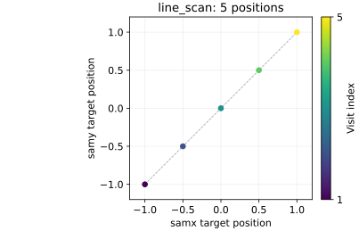
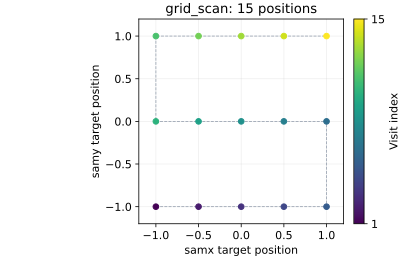
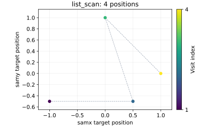
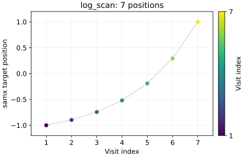
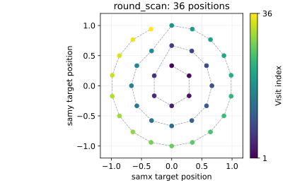
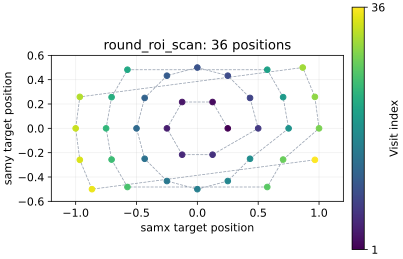
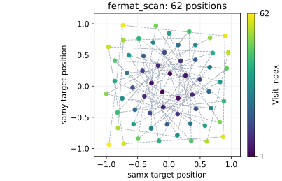
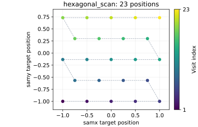
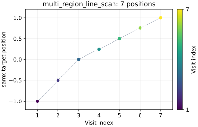
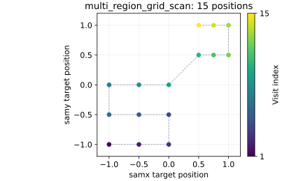

---
related:
  - title: Run your first scan
    url: getting-started/quick-start/04-run-your-first-scan.md
  - title: Access scan data
    url: getting-started/next-steps/access-scan-data.md
  - title: Readout priority
    url: learn/devices/readout-priority.md
---

# Built-in scan catalog

This reference covers the built-in acquisition scans in BEC. Beamline plugins can add
scans or change their inputs and defaults. In IPython, `scans.` followed by ++tab++
lists the installed scans, and `scans.<name>?` shows the interface published by your server.

Examples use simulated `dev.samx` and `dev.samy` devices. Positions and distances use the
corresponding motor's units; acquisition times use seconds. Each call returns a `ScanReport`.
For a guided first measurement, see [Run your first scan](../../getting-started/quick-start/04-run-your-first-scan.md).

## Scan lookup

| Scan | Pattern | Motors | Point count |
| --- | --- | --- | --- |
| [`acquire`](#acquire) | Acquisition at current positions | None moved | 1 logical point |
| [`time_scan`](#time_scan) | Repeated acquisition over time | None moved | `points` |
| [`line_scan`](#line_scan) | Equally spaced, coupled axis positions | One or more | `steps` |
| [`grid_scan`](#grid_scan) | All combinations of axis positions | Two or more | Product of axis counts |
| [`list_scan`](#list_scan) | Explicit, coupled position lists | One or more | Length of each list |
| [`log_scan`](#log_scan) | Coupled positions with increasing spacing | One or more | `steps` |
| [`round_scan`](#round_scan) | Concentric rings | Two | `pos_in_first_ring * n * (n + 1) / 2`, where `n = number_of_rings` |
| [`round_roi_scan`](#round_roi_scan) | Circular shells clipped to a rectangle | Two | Number of retained positions |
| [`fermat_scan`](#fermat_scan) | Fermat spiral clipped to a rectangle | Two | Number of generated positions |
| [`hexagonal_scan`](#hexagonal_scan) | Staggered rows clipped to a rectangle | Two | Number of retained positions |
| [`multi_region_line_scan`](#multi_region_line_scan) | Consecutive line regions | One | Combined region counts, minus shared boundaries |
| [`multi_region_grid_scan`](#multi_region_grid_scan) | Consecutive rectangular grids | Two | Sum of each grid's axis-count product |
| [`cont_line_scan`](#cont_line_scan) | Moving acquisition near predefined targets | One | `steps` expected readouts |
| [`line_sweep_scan`](#line_sweep_scan) | Moving acquisition on readback updates | One | Variable; no predefined count |

## Shared settings

### Coordinates and return position

Use distinct motors in repeated argument bundles. All motion scans below require `relative` explicitly. With `relative=False`, supplied
positions are absolute. With `relative=True`, the scan adds the motor positions recorded
during preparation to the supplied offsets, including region bounds and ring centers.
Relative acquisition scans return to those starting positions on normal completion;
absolute scans leave the motors at the final trajectory position.

Limits are checked against the resulting positions. Relative scans normally also attempt
the return move in their exception hook; interruption without that hook, or a device
failure, can prevent the return. Neither `acquire` nor `time_scan` moves motors.

### Acquisition options

These defaults apply to the unmodified built-ins. The ten step scans are the scans under
[Step trajectories](#step-trajectories).

| Option | Default | Meaning | Supported scans |
| --- | --- | --- | --- |
| `exp_time` | `0` | Exposure time requested from devices | All acquisition scans |
| `frames_per_trigger` | `1` | Frames per trigger for devices supporting that setting | Step scans, `acquire`, `cont_line_scan`, `line_sweep_scan` |
| `settling_time` | `0` | Delay before the software trigger | Step scans, `acquire`, `time_scan` |
| `settling_time_after_trigger` | `0` | Delay after triggering and before reading | Step scans and `acquire` |
| `readout_time` | `0` | Readout-time configuration for devices supporting it | Step scans, `acquire`, `cont_line_scan` |
| `burst_at_each_point` | `1` | Trigger/read cycles at each logical point | Step scans and `acquire` |

Step scans with `N` positions expect `N * burst_at_each_point` monitored readouts.
`acquire` expects `burst_at_each_point` readouts at its one logical point. Detector frames
are separate from this readout count; increasing `frames_per_trigger` does not add motor
positions. Exposure and settling times must be nonnegative, and frame/burst counts at least one.

### Client options

The client accepts these options in addition to the scan's own parameters:

| Option | Default | Meaning |
| --- | --- | --- |
| `monitored` | `None` | Per-scan selection of devices to assign to monitored readout |
| `on_request` | `None` | Per-scan selection of devices to assign to on-request readout |
| `metadata` | `None` | Metadata merged with the client's metadata for this request |
| `file_suffix`, `file_directory` | `None` | Overrides of the client's file settings for this scan |
| `scan_queue` | `None` | Target queue; otherwise the client's default queue |
| `hide_report` | `False` | Suppress the interactive progress display |
| `callback`, `async_callback` | `None` | Callbacks for scan segments |

Enabled devices participate according to their
[readout priorities](../../learn/devices/readout-priority.md). Motion scans also assign
scan motors to monitored readout. `hide_report` controls the display, not whether the
server executes the request. The
[client implementation](https://github.com/bec-project/bec/blob/4b027618357ca18c9d5f878177cbc15b27da219f/bec_lib/bec_lib/scans.py)
defines the common options; each entry below describes the scan-specific inputs.

## Static and time acquisition

### `acquire`

Acquire at the current device positions without moving a motor.

- **Inputs:** no motor or trajectory arguments.
- **Options:** all shared acquisition options.
- **Counts:** one logical point; `burst_at_each_point` monitored readouts.

```python
scans.acquire(exp_time=0.1, burst_at_each_point=3)
```

This records three acquisitions at the same position. For repeated acquisition with a
specified interval, use [`time_scan`](#time_scan).

[Source](https://github.com/bec-project/bec/blob/4b027618357ca18c9d5f878177cbc15b27da219f/bec_server/bec_server/scan_server/scans/acquire.py).

### `time_scan`

Acquire a specified number of times without moving motors.

- **Inputs:** `points: int`, `interval: float` (nonnegative seconds).
- **Options:** `exp_time=0`, `settling_time=0`.
- **Counts:** `points` logical points and monitored readouts.
- **Timing:** after each acquisition except the last, sleep for
  `max(interval - exp_time, 0)`. Trigger/read time and settling contribute to the actual
  interval; this is not a guarantee of exact wall-clock spacing.

```python
scans.time_scan(5, 0.5, exp_time=0.1)
```

Unlike `acquire` bursts, `time_scan` takes an explicit interval. It has no
`burst_at_each_point` parameter.

[Source](https://github.com/bec-project/bec/blob/4b027618357ca18c9d5f878177cbc15b27da219f/bec_server/bec_server/scan_server/scans/time_scan.py).

## Step trajectories

At each trajectory position, motors finish moving before the software trigger/read cycle.
All entries in this section support the shared acquisition options and require `relative`.
The plots show the positions from each example with the default one readout per position.
Colors progress from the first to the last visit; dashed lines join successive targets and
represent travel between them, not acquisition during motion.

### `line_scan`

Move one or more motors through equally spaced positions together.

- **Inputs:** one or more repeated `(device, start, stop)` bundles; required
  `steps: int` greater than zero.
- **Counts:** `steps` positions, including start and stop when `steps > 1`.
- **Multiple motors:** each motor advances through its own range at the same point index;
  the scan follows a line through the combined coordinates, not a grid.

```python
scans.line_scan(
    dev.samx, -1, 1, dev.samy, -1, 1,
    steps=5, relative=False, exp_time=0.1,
)
```



For all axis combinations, use [`grid_scan`](#grid_scan); for explicit positions,
use [`list_scan`](#list_scan).

[Source](https://github.com/bec-project/bec/blob/4b027618357ca18c9d5f878177cbc15b27da219f/bec_server/bec_server/scan_server/scans/line_scan.py).

### `grid_scan`

Visit every combination of the supplied axis positions.

- **Inputs:** two or more repeated `(device, start, stop, steps)` bundles. Each axis count
  is a positive integer.
- **Options:** `snaked=True` reverses traversal on alternate passes; `False` repeats the
  same direction. The first supplied motor is the fastest-changing axis.
- **Counts:** product of the axis counts. Start and stop are included on axes with more
  than one position.

```python
scans.grid_scan(
    dev.samx, -1, 1, 5, dev.samy, -1, 1, 3,
    relative=False, exp_time=0.1,
)
```



This example has 15 positions, rather than the five coupled positions of a two-motor line scan.

[Source](https://github.com/bec-project/bec/blob/4b027618357ca18c9d5f878177cbc15b27da219f/bec_server/bec_server/scan_server/scans/grid_scan.py).

### `list_scan`

Visit explicit positions in the order provided.

- **Inputs:** one or more repeated `(device, positions)` bundles, where `positions` is
  a list of floats. All lists must have equal, nonzero length.
- **Counts:** the length of one list, not the product of the list lengths.
- **Multiple motors:** entries at the same list index form one combined position.

```python
scans.list_scan(
    dev.samx, [-1.0, 0.5, 0.0, 1.0],
    dev.samy, [-0.5, -0.5, 1.0, 0.0],
    relative=False, exp_time=0.1,
)
```



Use this when an evenly spaced trajectory does not describe the required positions.

[Source](https://github.com/bec-project/bec/blob/4b027618357ca18c9d5f878177cbc15b27da219f/bec_server/bec_server/scan_server/scans/list_scan.py).

### `log_scan`

Move one or more motors together with logarithmically increasing spacing along their ranges.

- **Inputs:** one or more `(device, start, stop)` bundles; required positive `steps: int`.
- **Spacing:** normalized fractions are `(logspace(0, 1, steps) - 1) / 9`; each fraction
  is mapped onto `start + fraction * (stop - start)`.
- **Counts:** `steps` positions. Motor coordinates can be zero or negative, or cross zero;
  it is the distance fraction that is logarithmically spaced.

```python
scans.log_scan(dev.samx, -1, 1, steps=7, relative=False, exp_time=0.1)
```



For constant spacing, use [`line_scan`](#line_scan).

[Source](https://github.com/bec-project/bec/blob/4b027618357ca18c9d5f878177cbc15b27da219f/bec_server/bec_server/scan_server/scans/log_scan.py).

### `round_scan`

Visit concentric rings, from the inner ring outwards, with more positions on each ring.

- **Inputs:** `motor_1`, `motor_2`, `inner_radius`, `outer_radius`,
  `number_of_rings`, `pos_in_first_ring`, in that positional order.
- **Constraints:** finite radii with `0 <= inner_radius < outer_radius`; positive integer
  ring and first-ring counts. Both axes should use compatible distance units.
- **Options:** `center_1=0`, `center_2=0` define the center in the chosen coordinates.
- **Rings:** ring `k`, starting at 1, has radius
  `inner_radius + k * (outer_radius - inner_radius) / number_of_rings` and
  `k * pos_in_first_ring` positions. The inner boundary is excluded and the outer included;
  no separate center point is added. A single ring lies at `outer_radius`.

```python
scans.round_scan(
    dev.samx, dev.samy, 0, 1, 3, 6,
    relative=False, exp_time=0.1,
)
```



This example has `6 + 12 + 18 = 36` positions. For shells restricted to a rectangular
region, use [`round_roi_scan`](#round_roi_scan).

[Source](https://github.com/bec-project/bec/blob/4b027618357ca18c9d5f878177cbc15b27da219f/bec_server/bec_server/scan_server/scans/round_scan.py).

### `round_roi_scan`

Generate circular shells and retain only positions inside a rectangular region of interest.

- **Inputs:** `motor_1`, `start_motor_1`, `stop_motor_1`, `motor_2`,
  `start_motor_2`, `stop_motor_2`, `shell_spacing`, `pos_in_first_ring`.
- **Constraints:** positive shell spacing and first-shell count; compatible axis distance units.
- **Options:** `center_1=0`, `center_2=0`. The center may be outside the rectangle.
- **Counts:** depend on how many shell positions fall inside the bounds. No separate center
  point is added; choose spacing and bounds that retain at least one position.

```python
scans.round_roi_scan(
    dev.samx, -1, 1, dev.samy, -0.5, 0.5, 0.25, 6,
    relative=False, exp_time=0.1,
)
```



Unlike `round_scan`, the inputs describe rectangular bounds and shell spacing, not a ring count.

[Source](https://github.com/bec-project/bec/blob/4b027618357ca18c9d5f878177cbc15b27da219f/bec_server/bec_server/scan_server/scans/round_roi_scan.py).

### `fermat_scan`

Generate a Fermat spiral around the midpoint of a rectangle and retain positions inside it.

- **Inputs:** `motor1`, `start_motor1`, `stop_motor1`, `motor2`, `start_motor2`,
  `stop_motor2`, and positive `step`. Both axes should use compatible distance units.
- **Options:** `spiral_type=0` changes the angular increment; its accepted range is 0–2.
  `optim_trajectory=None` preserves generation order. `"corridor"`, `"shell"`, or `"nearest"`
  reorder the generated positions to change the travel path.
- **Counts:** depend on bounds and step. No separate center point is added; ensure the
  generated trajectory is nonempty. `step` controls spatial density, not an axis point count.

```python
scans.fermat_scan(
    dev.samx, -1, 1, dev.samy, -1, 1, 0.25,
    relative=False, exp_time=0.1,
)
```



Trajectory optimization changes visit order, not the set of measurement positions.

[Source](https://github.com/bec-project/bec/blob/4b027618357ca18c9d5f878177cbc15b27da219f/bec_server/bec_server/scan_server/scans/fermat_scan.py).

### `hexagonal_scan`

Visit staggered rows within rectangular bounds; alternate rows shift by half the first-axis step.

- **Inputs:** `motor1`, `start_motor1`, `stop_motor1`, `step_motor1`, `motor2`,
  `start_motor2`, `stop_motor2`, `step_motor2`.
- **Constraints:** positive step distances and nondecreasing bounds. These are distances,
  unlike the integer axis counts supplied to `grid_scan`.
- **Options:** `snaked=True`; the first motor traverses each row and the second selects rows.
- **Counts:** number of positions retained inside the bounds. For a regular hexagonal lattice,
  choose row spacing `step_motor2 = sqrt(3) / 2 * step_motor1`.

```python
scans.hexagonal_scan(
    dev.samx, -1, 1, 0.5, dev.samy, -1, 1, 0.4330127018922193,
    relative=False, exp_time=0.1,
)
```



[Source](https://github.com/bec-project/bec/blob/4b027618357ca18c9d5f878177cbc15b27da219f/bec_server/bec_server/scan_server/scans/hexagonal_scan.py).

### `multi_region_line_scan`

Visit a sequence of line regions on one motor, with an independent count for each region.

- **Inputs:** `motor`; required keyword `regions=[(start, stop, steps), ...]`.
  Supply at least one region and positive counts.
- **Counts:** concatenate inclusive region positions. If the end of one region is close
  to the start of the next (`numpy.isclose`), omit the next region's repeated first point.
  Regions otherwise retain their order, including gaps and reversed ranges.

```python
scans.multi_region_line_scan(
    dev.samx, regions=[(-1.0, 0.0, 3), (0.0, 1.0, 5)],
    relative=False, exp_time=0.1,
)
```



This example has seven positions, not eight. For multiple motors at explicit paired
positions, use [`list_scan`](#list_scan).

[Source](https://github.com/bec-project/bec/blob/4b027618357ca18c9d5f878177cbc15b27da219f/bec_server/bec_server/scan_server/scans/multi_region_line_scan.py).

### `multi_region_grid_scan`

Visit a sequence of rectangular grids on two motors.

- **Inputs:** `motor1`, `motor2`; required keyword
  `regions=[((start1, stop1, steps1), (start2, stop2, steps2)), ...]`.
  Supply at least one paired region and positive axis counts.
- **Options:** `snaked=True`; the first motor changes fastest within each grid.
- **Counts:** sum of each grid's axis-count product. Regions are concatenated in order;
  overlapping positions are retained, and snaking starts afresh in each region.

```python
scans.multi_region_grid_scan(
    dev.samx, dev.samy,
    regions=[((-1.0, 0.0, 3), (-1.0, 0.0, 3)),
             ((0.5, 1.0, 3), (0.5, 1.0, 2))],
    relative=False, exp_time=0.1,
)
```



This example has `9 + 6 = 15` positions.

[Source](https://github.com/bec-project/bec/blob/4b027618357ca18c9d5f878177cbc15b27da219f/bec_server/bec_server/scan_server/scans/multi_region_grid_scan.py).

## Moving acquisition

Both built-ins below use software triggering while the motor moves. Neither accepts
`burst_at_each_point`. Their recorded samples depend on motor readback updates and
acquisition timing, so they have different constraints from a stationary step scan.

### `cont_line_scan`

Move continuously and acquire when the readback is close to successive predefined targets.

- **Inputs:** `device`, `start`, `stop`, `steps`; required keyword `relative`.
- **Options:** `offset=None`, `atol=None`, `exp_time=0`, `readout_time=0`,
  `frames_per_trigger=1`.
- **Counts:** `steps` expected monitored readouts. Use at least two targets: preparation
  computes spacing from the first two. Use increasing targets and a positive motor velocity.
- **Device requirements:** readable `velocity`, `acceleration`, and readback precision.
  Motor settings are used as configured; the scan does not set a requested speed.
- **Motion:** starts at `start - offset` in the resolved coordinates, then moves to `stop`.
  The approach position is included in the limit check. With `offset=None`, the approach
  distance is calculated from acceleration and velocity.
- **Sampling:** `atol` is the absolute position-matching tolerance; its automatic value
  depends on velocity, exposure and precision. Skipping a target, finishing before all
  targets are acquired, or insufficient time per step causes an abortion.

```python
scans.cont_line_scan(
    dev.samx, -1, 1, 5, relative=False, exp_time=0.1,
)
```

Use [`line_scan`](#line_scan) to stop at each target. Use [`line_sweep_scan`](#line_sweep_scan)
for readback-driven acquisition without a predefined target grid. Continuous-line samples
match a tolerance window rather than an exact stationary position.

[Source](https://github.com/bec-project/bec/blob/4b027618357ca18c9d5f878177cbc15b27da219f/bec_server/bec_server/scan_server/scans/cont_line_scan.py).

### `line_sweep_scan`

Acquire in response to readback updates while one motor moves from start to stop.

- **Inputs:** `device`, `start`, `stop`; required keyword `relative`.
- **Options:** `exp_time=0`, `frames_per_trigger=1`, `min_update=0`, `max_update=0`.
- **Timing:** `min_update` adds a delay after each acquisition. Positive `max_update` allows
  acquisition when no readback update has arrived within that time; `0` disables this fallback.
  Both values are nonnegative seconds, not exact sampling periods.
- **Counts:** determined during motion. There is no `steps` argument or predefined point
  count; the initial count is zero. Actual samples depend on update rate, motion duration
  and the trigger/read cycle. Short moves may yield few or no samples.

```python
scans.line_sweep_scan(
    dev.samx, -1, 1, relative=False, exp_time=0.1, min_update=0.1,
)
```

The scan first moves to start, then acquires during the move to stop. For acquisition
near a fixed number of targets, use [`cont_line_scan`](#cont_line_scan).

[Source](https://github.com/bec-project/bec/blob/4b027618357ca18c9d5f878177cbc15b27da219f/bec_server/bec_server/scan_server/scans/line_sweep_scan.py).

## Other requests

`mv` and `umv` are move requests, not acquisition scans. They do not produce the ordinary
scan-point series and master-file result described above. `device_rpc` is an internal
request used for device communication, not an acquisition entry in the client catalog.
See [Move a device](../../getting-started/quick-start/03-move-a-device.md) and
[Important BEC commands](important-commands.md) for related commands.
